# Agora

**The self-hosted workspace to found and run an association**: set up the organization, see who does what, follow projects and their progress, manage poles, members, events, money and documents. All in one place, in English or French.

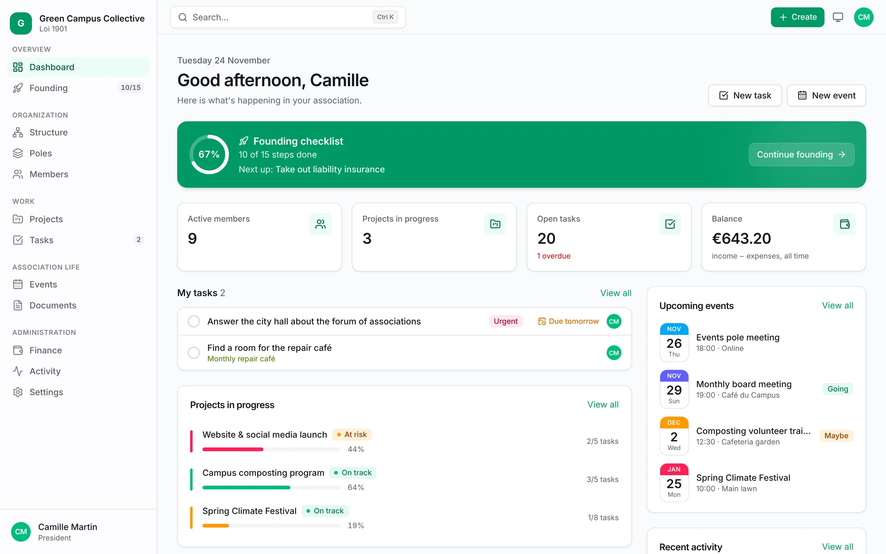

---

## Why Agora?

Before building it, I looked at what already exists:

| Tool                                                      | What it does well                         | What was missing for this need                                                 |
| --------------------------------------------------------- | ----------------------------------------- | ------------------------------------------------------------------------------ |
| [Paheko](https://paheko.cloud) (ex-Garradin), open source | Members, double-entry accounting, website | No projects/tasks, no poles, no founding guide                                 |
| [Galette](https://galette.eu), open source                | Membership management                     | Members only                                                                   |
| [Dolibarr](https://www.dolibarr.org), open source ERP     | Very complete (CRM, invoicing…)           | Built for companies, heavy to configure for a student or volunteer association |
| AssoConnect, HelloAsso, Yapla (SaaS)                      | Payments, memberships, websites           | Paid and/or hosted by a third party, little project management                 |
| Notion, Trello, ClickUp                                   | Flexible project management               | You have to build everything yourself, nothing specific to associations        |

None of them combined **the founding process + the organization (board, poles, who does what) + project tracking** in a simple tool that you can host yourself. Agora does.

## Features

|                           |                                                                                                                                                                                                                                                                                 |
| ------------------------- | ------------------------------------------------------------------------------------------------------------------------------------------------------------------------------------------------------------------------------------------------------------------------------- |
| 🚀 **Founding checklist** | 16 steps from the purpose to the bank account (statutes, constitutive general assembly, declaration, insurance…). Each step can be assigned, dated, skipped or customized. Progress per phase.                                                                                  |
| 🏛️ **Structure**          | Live organization chart (association → board → poles), **"who does what"** table of recurring responsibilities, membership matrix (who is in which pole, who leads it).                                                                                                         |
| 🧩 **Poles**              | Working groups with leads and members, their projects, open tasks, responsibilities and events.                                                                                                                                                                                 |
| 📁 **Projects**           | Status, priority, lead, team, dates, budget. **Progress** computed from tasks and milestones (or set manually), **health** (on track / at risk / off track), progress updates, milestones, linked transactions, events and documents. **Cards** and **Timeline (Gantt)** views. |
| ✅ **Tasks**              | **Kanban board** with drag and drop, list view, filters (mine, unassigned, project, pole, priority, assignee), due dates and overdue warnings, comments.                                                                                                                        |
| 👥 **Members**            | Directory, roles (administrator / manager / member), board positions, poles, skills, membership fee status, **invitation links** and password reset links (no email server needed), deactivation.                                                                               |
| 📅 **Events & meetings**  | General assemblies, board meetings, pole meetings, workshops. List and **monthly calendar**, RSVP, agenda and **minutes**.                                                                                                                                                      |
| 💶 **Finance**            | Income and expenses, categories, monthly chart, expenses by category, project budgets vs. spending, **yearly membership fees**, CSV export.                                                                                                                                     |
| 📄 **Documents**          | Upload files or save links (statutes, minutes, guides…), categories, search.                                                                                                                                                                                                    |
| 📣 **Dashboard**          | Your tasks, projects in progress, upcoming events, announcements, recent activity, founding progress.                                                                                                                                                                           |
| 🔎 **Everywhere**         | Global search (<kbd>Ctrl</kbd>+<kbd>K</kbd>), activity log, English/French, light/dark theme, accent color, mobile layout, JSON backup.                                                                                                                                         |

<table>
  <tr>
    <td>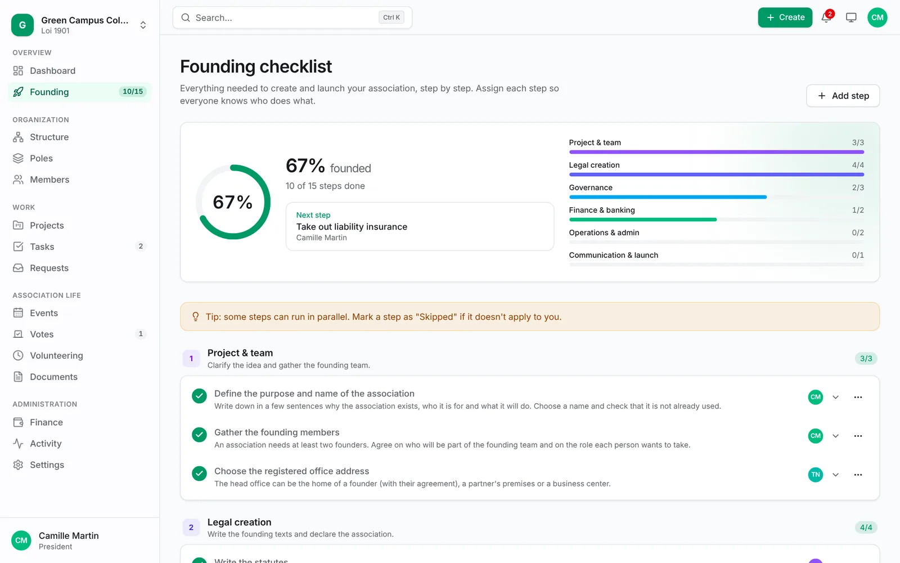</td>
    <td>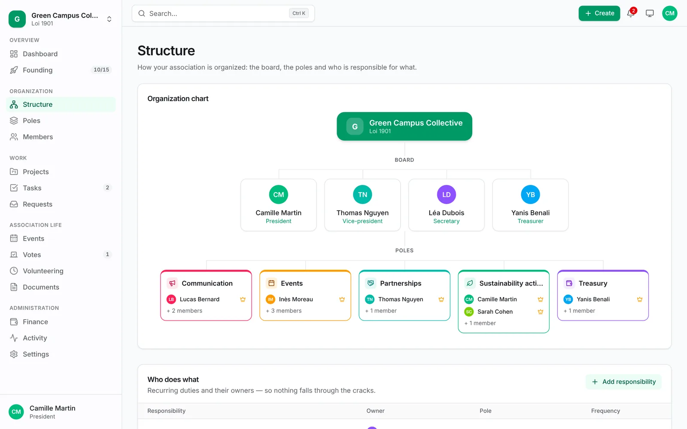</td>
  </tr>
  <tr>
    <td>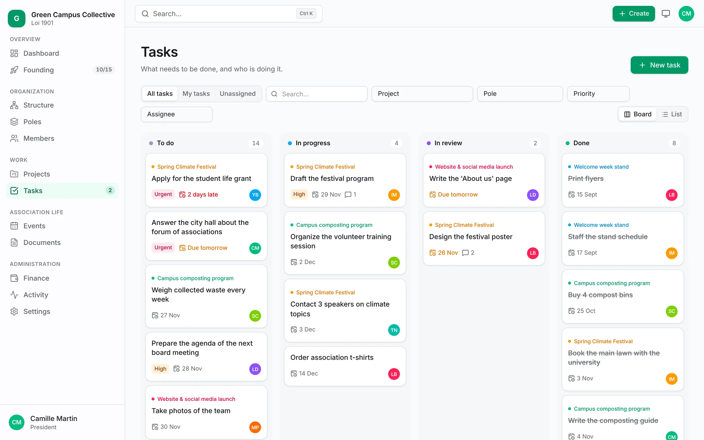</td>
    <td>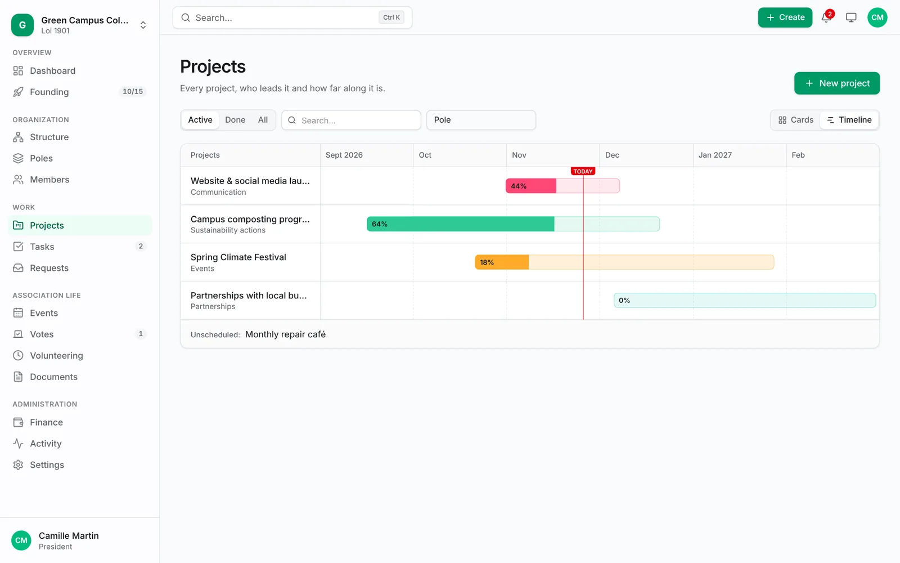</td>
  </tr>
  <tr>
    <td>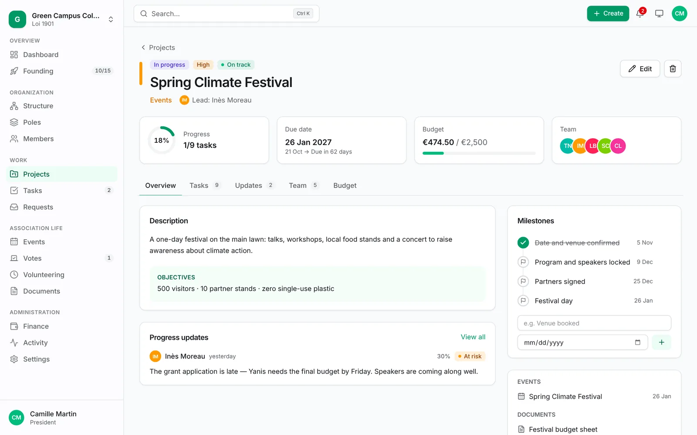</td>
    <td>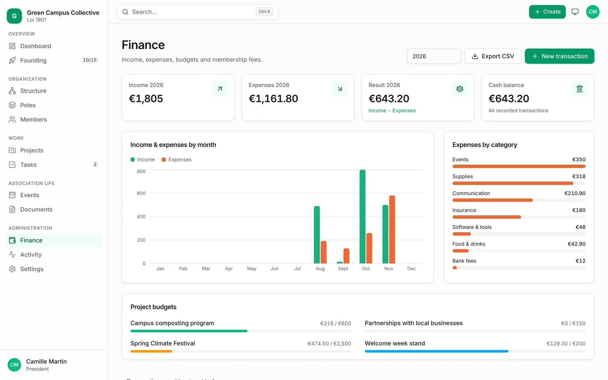</td>
  </tr>
  <tr>
    <td>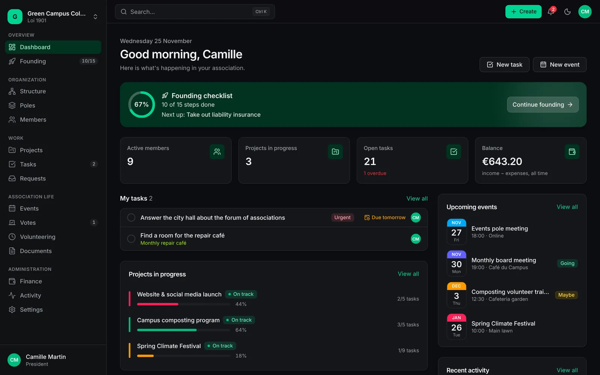</td>
    <td>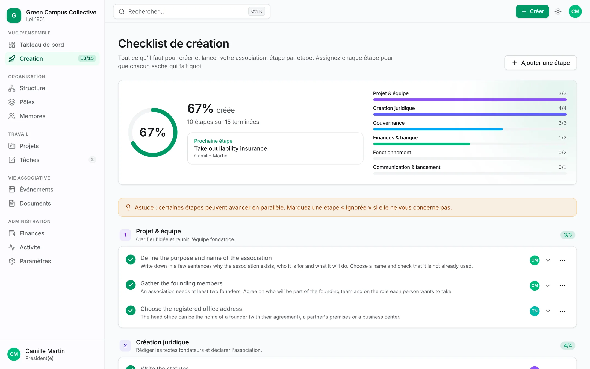</td>
  </tr>
</table>

<p align="center">
  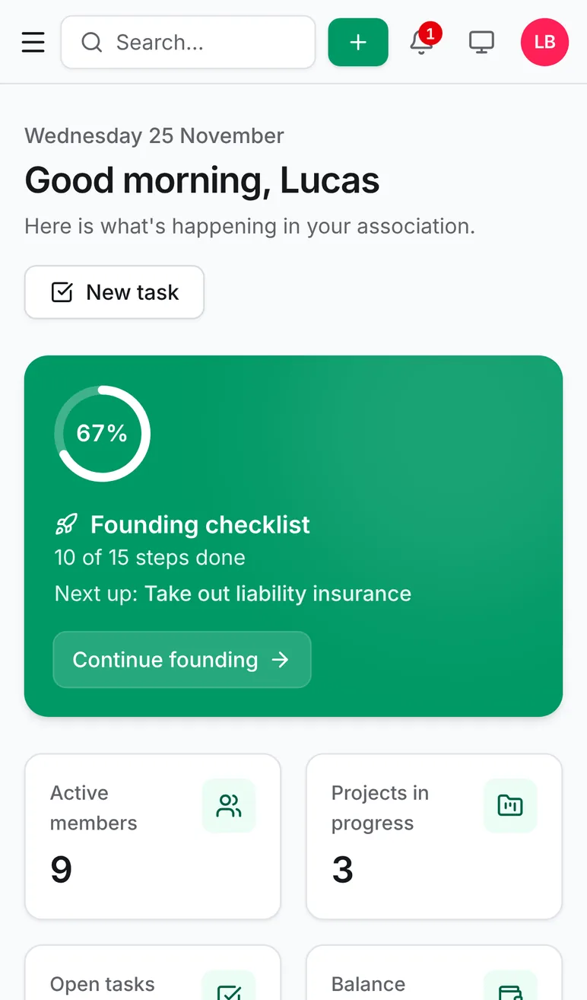
  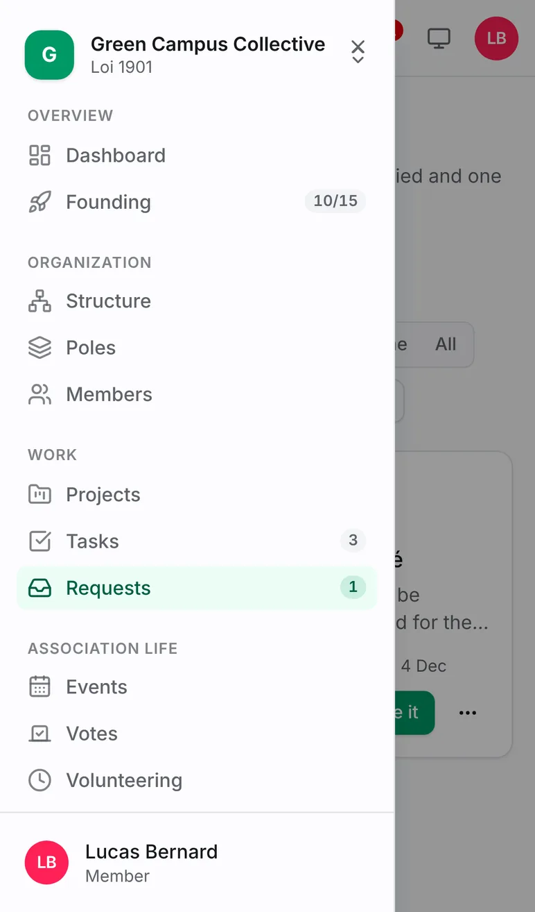
  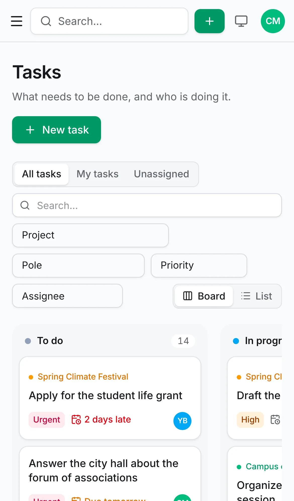
</p>

---

## Run it on your computer

### Option A: with Node.js (best to test and modify the code)

Requirements: [Node.js](https://nodejs.org) **20.19 or newer** (22 LTS recommended).

```bash
npm install
npm run setup      # creates .env, the SQLite database and the Prisma client
npm run dev        # http://localhost:3000
```

Open http://localhost:3000. On the first visit, a **setup wizard** creates your association and your administrator account (and, if you want, the founding checklist and suggested poles).

Want to explore with sample data first?

```bash
npm run db:seed    # loads the "Green Campus Collective" demo association
```

Then sign in with `camille@greencampus.example` / `agora1234` (administrator). Other demo accounts: `yanis@`, `lea@`, `thomas@`, `ines@`, `lucas@`, `sarah@greencampus.example`, same password. To start over: `npm run db:seed -- --reset` (⚠️ deletes everything).

To run the optimized version:

```bash
npm run build
npm start          # http://localhost:3000
```

### Option B: with Docker (best to keep it running)

```bash
docker compose up -d --build
```

Open http://localhost:3000. The database, the uploaded files and the session secret are stored in the `agora-data` Docker volume. Migrations are applied automatically at each start. Load the demo with `docker compose exec agora npm run db:seed`.

### Use it from other devices (phone, other members' laptops)

Agora listens on your whole network. Find your computer's local IP (e.g. `192.168.1.20`) and open `http://192.168.1.20:3000` from another device on the same Wi-Fi.
In development mode (`npm run dev`), add that IP to `allowedDevOrigins` in `next.config.ts`.
To expose it on the internet, put it behind a reverse proxy with HTTPS (Caddy, Nginx, Traefik…) and set `SECURE_COOKIES=true`.

---

## Configuration

All settings live in `.env` (created by `npm run setup`, see `.env.example`):

| Variable         | Default                | Description                         |
| ---------------- | ---------------------- | ----------------------------------- |
| `DATABASE_URL`   | `file:./data/agora.db` | SQLite database file                |
| `AUTH_SECRET`    | random                 | Secret used to sign session cookies |
| `UPLOAD_DIR`     | `./data/uploads`       | Where uploaded documents are stored |
| `MAX_UPLOAD_MB`  | `20`                   | Maximum upload size                 |
| `SECURE_COOKIES` | `false`                | `true` when served over HTTPS       |

Association details (name, legal info, membership fee, fiscal year, accent color, language) are edited in the app: **Settings → Association**.

## Backups

Everything is in the `data/` folder: copy `data/agora.db` and `data/uploads/`, and you have a full backup. Administrators can also download a JSON export (**Settings → Data**) and transactions as CSV (**Finance → Export CSV**).

With Docker:

```bash
docker run --rm -v agora-data:/data -v "$PWD":/backup alpine tar czf /backup/agora-backup.tgz -C /data .
```

## Roles and permissions

|                                                                        | Member | Manager | Administrator |
| ---------------------------------------------------------------------- | :----: | :-----: | :-----------: |
| See everything, comment, RSVP, edit own profile                        |   ✅   |   ✅    |      ✅       |
| Create tasks, edit own/assigned tasks, add documents                   |   ✅   |   ✅    |      ✅       |
| Manage projects they lead (or projects of poles they lead)             |   ✅   |   ✅    |      ✅       |
| Manage poles, projects, events, founding steps, finance, announcements |        |   ✅    |      ✅       |
| Manage members, roles, invitations, association settings, backups      |        |         |      ✅       |

The **board position** (president, treasurer, secretary…) is independent from the app role: it is shown on the organization chart. Secretaries and presidents can also write meeting minutes.

---

## Tech stack (and why)

|                                                                                       |                                                                                                                                                                               |
| ------------------------------------------------------------------------------------- | ----------------------------------------------------------------------------------------------------------------------------------------------------------------------------- |
| [Next.js 16](https://nextjs.org) (App Router, Server Actions) + React 19 + TypeScript | One project for the interface and the server, no separate API to maintain                                                                                                     |
| [Prisma 7](https://www.prisma.io) + **SQLite**                                        | A single file as database: nothing to install, trivial backups. Switching to PostgreSQL later only needs the `provider` change in `prisma/schema.prisma` and a driver adapter |
| [Tailwind CSS 4](https://tailwindcss.com)                                             | Custom design system (light/dark, accent colors) without a UI framework                                                                                                       |
| jose + bcrypt                                                                         | Simple, self-contained authentication (signed cookie sessions, invitation links)                                                                                              |
| Recharts, lucide-react, sonner                                                        | Charts, icons, notifications                                                                                                                                                  |
| Vitest + Playwright                                                                   | Unit tests and an end-to-end test of the whole journey                                                                                                                        |

## Project structure

```
prisma/
  schema.prisma        ← the data model (start here)
  migrations/          ← database history
  seed.ts              ← demo data
src/
  app/
    (auth)/            ← login, setup wizard, invitation pages
    (app)/             ← the application (one folder per page)
    api/               ← search, file download/upload, exports, health check
  actions/             ← server actions: every write to the database
  components/          ← UI kit (ui/), forms, and components per feature
  lib/
    i18n/en.ts, fr.ts  ← all texts of the interface
    constants.ts       ← allowed values (statuses, roles, categories…)
    permissions.ts     ← who can do what
    foundation-template.ts ← the founding checklist
    progress.ts        ← project progress and health rules
tests/
  unit/                ← Vitest
  e2e/                 ← Playwright
```

## Improving it

Useful commands:

| Command                                                 | What it does                                                          |
| ------------------------------------------------------- | --------------------------------------------------------------------- |
| `npm run dev`                                           | Development server with hot reload                                    |
| `npm run db:studio`                                     | Browse and edit the database in your browser (Prisma Studio)          |
| `npm run db:migrate -- --name my_change`                | After editing `prisma/schema.prisma`: creates and applies a migration |
| `npm run lint` / `npm run typecheck` / `npm run format` | Code quality                                                          |
| `npm test`                                              | Unit tests                                                            |
| `npm run build && npm run test:e2e`                     | End-to-end test (first time: `npx playwright install chromium`)       |

Recipes:

- **Add a field** (e.g. a member's student ID): add it in `prisma/schema.prisma` → `npm run db:migrate -- --name add_student_id` → add the input in `src/components/members/member-fields.tsx` → read it in `src/actions/members.ts` → display it in `src/app/(app)/members/[id]/page.tsx`.
- **Change a text or translate**: `src/lib/i18n/en.ts` and `fr.ts` (TypeScript tells you if a key is missing in one language).
- **Add a status / category**: `src/lib/constants.ts`, then its label in both dictionaries, and its color in `src/lib/colors.ts`.
- **Adapt the founding checklist** to your country: `src/lib/foundation-template.ts` (or simply edit the steps in the app).
- **Update dependencies**: `npm outdated`, then `npm install <package>@latest`, then run the checks above. For Next.js majors, read `node_modules/next/dist/docs/01-app/02-guides/upgrading/`. The app already uses Cache Components, which become mandatory in Next.js 17.

Ideas for next steps: email notifications, recurring tasks, file previews, member self-registration form, HelloAsso import, PostgreSQL for multi-user hosting at scale.

## Notes

- The founding checklist follows the French "association loi 1901" process and links to official French resources; every step can be edited for another country.
- Dates entered in forms are stored as you type them ("wall time"), so they display the same for everyone.
- This project has no license yet: add one (e.g. MIT, AGPL) before publishing it.
